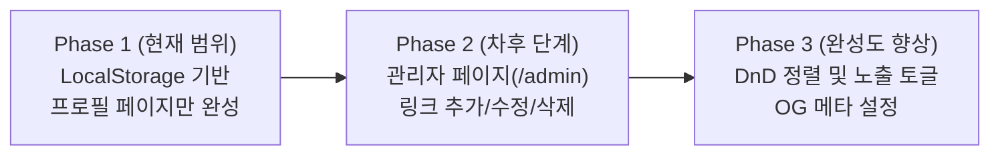

# [PRD] 개인용 링크트리 서비스 — 마이링크 (myLink)

> **버전**: v1.3 (더미 데이터 및 Mock API/JSON 연동 명세 반영)  
> **목적**: 기능 시연(Live Demo) 흐름에 맞춘 단계별 빌드. **1단계에서는 대시보드/통계 없이 LocalStorage 및 표준 Mock 데이터 기반 프로필 페이지만 집중 구현**합니다.

---

## 1. 프로젝트 개요 (Overview)

### 1.1 서비스 소개
**마이링크 (myLink)**는 개인 브랜딩과 포트폴리오를 한눈에 보여주는 링크-인-바이오(Link-in-bio) 서비스입니다.  
시연 목적에 맞추어 복잡한 백엔드 설정 없이, **클라이언트 환경의 LocalStorage와 Mock 데이터**를 기반으로 즉시 동작하고 데이터가 유지되는 프로필 페이지를 1차 목표로 구현합니다.

### 1.2 디자인 시스템 및 기술 스택 원칙: shadcn/ui × 토스 디자인 시스템(TDS)
본 프로젝트는 **[shadcn/ui](https://ui.shadcn.com/)의 검증된 컴포넌트 아키텍처**와 **토스 디자인 시스템(TDS)의 정교한 비주얼 토큰 및 마이크로 인터랙션**을 결합하여 디자인 시스템을 구성합니다.

- **컴포넌트 인프라 (shadcn/ui 기반)**:
  - 모든 기본 UI 블록(Button, Card, Badge, Dialog, Toast, Avatar 등)은 shadcn/ui의 접근성(a11y) 표준과 headless 구조를 채택합니다.
  - 컴포넌트 코드가 프로젝트 내(`src/components/ui/`)에 직접 위치하여 TDS 스타일에 맞춘 커스텀 확장이 자유롭습니다.
- **비주얼 & 테마 시스템 (토스 디자인 시스템 - TDS 기반)**:
  - **색상 토큰**: 카노니컬 토스 블루(`blue-500: #3182F6`), TDS 회색조 배경(`grey-100: #F2F4F6`), 기본 텍스트(`grey-900: #191F28`), 보더/구분선(`grey-200: #E5E8EB`) 및 TDS 다크 팔레트를 shadcn/ui의 CSS 변수에 매핑하여 사용합니다.
  - **타이포그래피**: `Pretendard Variable`을 기본 폰트로 적용하고, 자간(`letter-spacing: -0.015em`) 및 숫자 고정폭(`tabular-nums`)을 반영합니다.
  - **인터랙션 피드백**: 터치 및 클릭 시 토스 고유의 쫀득한 마이크로 스케일 피드백(`active:scale-[0.98]`)과 부드러운 토스트 알림(Sonner 기반 토스 스타일 토스트)을 결합합니다.
  - **Tailwind CSS v4 연동**: 별도의 설정 파일 없이 `src/app/globals.css`의 `@theme` 및 CSS 변수를 통해 shadcn/ui와 TDS 토큰을 유기적으로 통합 관리합니다.

### 1.3 핵심 전략: 단계별(Phased) 접근
- **현재 단계 (Phase 1 - 현재 집중 범위)**:
  - **프로필 페이지(`/`) 단일 집중 구현**
  - 대시보드(`/admin`), 인증, 통계 기능은 배제
  - `LocalStorage` 기반 데이터 스토어 연동 (데이터가 로컬에 저장·유지되며, 최초 진입 시 기본 Mock 데이터로 자동 시딩)
  - 토스(Toss) 스타일의 세련된 인터랙션 및 라이트/다크 모드 완성도 확보
- **차후 단계 (Phase 2 - 추후 확장)**:
  - 관리자 대시보드(`/admin`) 및 시각적 편집 인터페이스
  - 드래그 앤 드롭 링크 순서 변경 및 노출(Show/Hide) 토글

---

## 2. 사용자 페르소나 및 시나리오 (User Personas & Scenarios)

### 2.1 대상 페르소나 (Target Personas)

| 페르소나 | 주요 특징 및 니즈 | 주요 디바이스 |
| :--- | :--- | :--- |
| **방문자 A<br>(채용 담당자 / 동료 개발자)** | - SNS, 이력서, 깃허브 링크를 통해 방문<br>- 지원자의 대표 프로젝트, 주요 기술 스택, 링크 모음을 한 화면에서 빠르고 군더더기 없이 확인하길 원함<br>- 연락처(이메일)를 빠르게 복사하여 문의하고자 함 | 모바일 (70%) / 데스크톱 (30%) |
| **소유자 / 시연자 B<br>(크리에이터 / 데모 진행자)** | - 복잡한 인프라나 백엔드 배포 없이 브라우저 환경에서 즉시 동작하는 프로필을 시연하고자 함<br>- 로컬 스토리지에 데이터가 안정적으로 적재·유지되는 구조를 보여주고자 함 | 데스크톱 / 브라우저 개발자 도구 |

---

### 2.2 상세 사용자 시나리오 (End-to-End Scenarios)

#### 📌 시나리오 1: 모바일 SNS 링크를 통한 프로필 탐색
1. **상황**: 방문자가 인스타그램 프로필이나 이력서에 첨부된 마이링크 URL(`https://...`)을 클릭하여 접속합니다.
2. **화면 반응**:
   - 모바일 최적화된 토스 스타일의 깔끔한 카드 레이아웃이 지연(Loading) 없이 즉시 렌더링됩니다.
   - 상단에 소유자의 아바타 사진, 이름("홍길동"), 명확한 한 줄 소개("Next.js와 UI 인터랙션을 좋아하는 프론트엔드 엔지니어")가 눈에 들어옵니다.
3. **사용자 행동**: 상단의 GitHub, LinkedIn 아이콘 바를 탭하여 소유자의 외부 소셜 프로필로 바로 이동해 이력을 추가 확인합니다.

#### 📌 시나리오 2: 카테고리별 프로젝트 확인 및 외부 이동
1. **상황**: 방문자가 소유자의 대표 작업물을 탐색하고자 스크롤을 내립니다.
2. **화면 반응**:
   - `프로젝트`, `블로그 & 아티클` 등 카테고리별로 시각적으로 정돈된 섹션 구분선과 링크 카드가 노출됩니다.
   - 각 링크 카드에는 타이틀, 핵심 설명, 기술 태그/강조 뱃지(`NEW`, `HOT` 등)가 깔끔하게 정돈되어 있습니다.
3. **사용자 행동**: 관심 있는 'AI 바이브 코딩 플레이그라운드' 카드를 터치합니다.
4. **인터랙션 피드백**:
   - 카드가 살짝 눌리는 마이크로 인터랙션(`active:scale-[0.98]`) 피드백이 제공된 후 새 탭에서 실제 프로젝트 URL이 열립니다.

#### 📌 시나리오 3: 원클릭 이메일 복사 및 연락
1. **상황**: 채용 담당자가 소유자에게 커피챗 또는 협업 제안 메일을 보내고자 합니다.
2. **사용자 행동**: 프로필 헤더 하단의 이메일 주소 배지를 클릭합니다.
3. **화면 반응**:
   - 클립보드에 이메일 주소(`gildong.hong@example.com`)가 즉시 복사됩니다.
   - 화면 하단에 *"이메일 주소를 복사했어요"*라는 토스 스타일의 부드러운 토스트 알림이 2.4초간 노출되었다가 자연스럽게 사라집니다.

#### 📌 시나리오 4: 야간 모드(다크 모드) 전환
1. **상황**: 어두운 환경에서 접속한 방문자가 눈의 피로를 줄이고자 합니다.
2. **사용자 행동**: 우측 상단의 테마 전환(해/달 아이콘) 버튼을 탭합니다.
3. **화면 반응**:
   - 배경이 눈이 편안한 딥 차콜/블랙(`bg-[#121212]`)으로, 카드가 세련된 다크 그레이(`bg-[#1E1E1E]`)로 즉시 부드럽게 전환됩니다.
   - 폰트와 소셜 아이콘의 명암비가 WCAG 접근성 기준을 충족하도록 최적화되어 가독성이 유지됩니다.

#### 📌 시나리오 5: [시연자 관점] LocalStorage 기반 데이터 지속성 검증
1. **상황**: 시연자가 청중에게 "로컬 스토리지 기반의 클라이언트 데이터 지속성"을 입증합니다.
2. **시연 행동 1**: 브라우저를 처음 열었을 때 `localStorage`에 데이터가 비어있음을 확인한 뒤, 페이지 로드와 동시에 기본 Mock 데이터가 자동 주입(Seed)되는 과정을 보여줍니다.
3. **시연 행동 2**: 브라우저 개발자 도구(F12 > Application > Local Storage)에서 프로필 이름을 "김토스"로 변경하거나 링크 항목을 수정한 뒤 페이지를 새로고침합니다.
4. **결과**: 외부 서버 요청 없이도 로컬 스토리지에 저장된 변경 데이터가 프로필 페이지에 그대로 유지되어 반영되는 것을 확인시켜 줍니다.

---

## 3. 1단계 집중 범위: 프로필 페이지 기능 명세 (Phase 1 Scope)

### 3.1 주요 기능 목록

| ID | 기능명 | 상세 내용 | 필수 여부 |
| :--- | :--- | :--- | :--- |
| **P1-01** | **LocalStorage & Mock 데이터 연동** | - 브라우저 `localStorage`에 데이터(`MYLINK_DATA_V1`)가 없으면 `src/mock/links.json` 기반의 기본 Mock 데이터를 자동 주입(Seed)<br>- 백엔드 연동 시 `GET /api/links` Mock API 또는 `public/data/links.json`을 사용하여 동일 데이터 조회 가능<br>- 로컬에 저장된 데이터를 읽어와 프로필 페이지 화면을 동적으로 렌더링 | `필수 (P0)` |
| **P1-02** | **프로필 헤더 영역** | - 아바타 이미지, 표시 이름, 한 줄 소개(Bio) 노출<br>- 이메일 주소 클릭 시 클립보드 복사 + shadcn 토스트 알림(Sonner) 피드백 제공 | `필수 (P0)` |
| **P1-03** | **소셜 링크 아이콘 바** | - GitHub, LinkedIn, Instagram, X(Twitter), 이메일 등 등록된 소셜 계정을 아이콘 바 형태로 노출<br>- 클릭 시 새 탭으로 외부 링크 연결 | `필수 (P0)` |
| **P1-04** | **카테고리별 링크 카드 그룹** | - 카테고리(예: '프로젝트', '소셜 링크', '블로그')별 헤더 및 구분선 표시<br>- 링크 카드 항목: 제목, 상세 설명, URL, 뱃지(예: 'NEW', 'HOT'), 아이콘<br>- 노출 활성화(`isVisible: true`)된 링크만 필터링하여 출력 | `필수 (P0)` |
| **P1-05** | **shadcn/ui × TDS 인터랙션 & 디자인** | - [shadcn/ui](https://ui.shadcn.com/) 표준 컴포넌트(Card, Button, Badge 등)를 뼈대로 채택<br>- 토스 디자인 시스템(TDS)의 컬러, 여백, 타이포그래피(Pretendard) 스타일 주입<br>- 카드 클릭/터치 시 TDS 고유의 `active:scale-[0.98]` 마이크로 애니메이션 및 부드러운 호버 피드백<br>- 모바일 뷰 최적화 (Max width 480px 중앙 정렬) | `필수 (P0)` |
| **P1-06** | **라이트 / 다크 모드 (TDS 어댑티브 팔레트)** | - 시스템 테마 감지 및 토글 스위치 지원<br>- shadcn/ui CSS 변수에 TDS 라이트(`grey-100` 배경, `grey-900` 텍스트) 및 다크(`dark-grey` 어댑티브 토큰) 팔레트를 정밀 매핑하여 일관된 명암비 확보 | `필수 (P0)` |

---

## 4. 데이터 구조 설계 (Phase 1 Schema)

LocalStorage에 저장되는 단일 데이터 구조로, 차후 어드민이 붙더라도 스키마 변경 없이 그대로 재사용 가능하도록 설계합니다.

```typescript
export interface MyLinkProfile {
  name: string;
  bio: string;
  email: string;
  avatarUrl: string;
}

export interface SocialLinks {
  github?: string;
  linkedin?: string;
  instagram?: string;
  x?: string;
  website?: string;
}

export interface LinkItem {
  id: string;
  categoryId: string;
  title: string;
  description?: string;
  url: string;
  badge?: string; // 예: 'NEW', 'HOT', '추천'
  icon?: string;
  isVisible: boolean; // 1단계에서는 true인 항목만 렌더링
  order: number;
}

export interface LinkCategory {
  id: string;
  name: string;
  order: number;
}

export interface MyLinkStore {
  profile: MyLinkProfile;
  socials: SocialLinks;
  categories: LinkCategory[];
  links: LinkItem[];
}
```

### 4.1 기본 제공 더미 데이터 및 Mock API 명세

프로필 초기 화면 렌더링 및 `localStorage` 시딩(Seeding), 백엔드 Mock 통신에 사용할 공식 더미 데이터를 정의합니다. 토스 디자인 시스템(TDS)의 톤앤매너(해요체 설명, 시맨틱 뱃지, 마이크로 태그)를 반영한 12종의 링크 항목이 포함되어 있습니다.

#### (1) 더미 데이터 소스 및 엔드포인트 구성
- **정적/로컬 JSON**:
  - `src/mock/links.json` : 로컬 컴포넌트/훅에서 직접 import하여 `localStorage` 초기 시딩에 사용
  - `public/data/links.json` : 클라이언트 정적 `fetch('/data/links.json')` 지원
- **코드형 데이터 및 타입**:
  - `src/types/link.ts` : `LinkItem`, `LinkCategory`, `CategoryInfo` 타입 정의
  - `src/data/links.ts` : `DUMMY_LINKS`, `LINK_CATEGORIES` 상수 데이터
- **백엔드 Mock Route Handler (App Router)**:
  - `GET /api/links` : 카테고리 필터링(`?category=`), 통합 검색(`?query=`), 정렬(`?sort=clicks|latest|order`), 페이지네이션(`?page=&limit=`) 지원
  - `POST /api/links` : 신규 링크 등록 Mock
  - `GET /api/links/:id` : 단건 링크 상세 조회
  - `PATCH /api/links/:id` : 클릭 수 증가 반영 Mock

#### (2) 카테고리별 더미 데이터 구성 (총 12종)

| 카테고리 | ID | 링크명 (Title) | 상세 설명 (TDS 해요체) | 뱃지/태그 |
| :--- | :--- | :--- | :--- | :--- |
| **프로젝트** | `link-01` | MyLink 프로필 서비스 | Next.js 16과 토스 디자인 시스템(TDS) 기반으로 제작한 프로필 링크 서비스예요. | `대표작` / Next.js 16, React 19, Tailwind CSS |
| **프로젝트** | `link-02` | AI 바이브 코딩 플레이그라운드 | LLM 에이전트와 페어 프로그래밍하여 아이디어를 신속하게 제품화하는 실험 공간이에요. | `NEW` / AI Agent, Gemini API, Fullstack |
| **프로젝트** | `link-03` | 기술 면접 질문 Q&A 아카이브 | 프론트엔드·CS 핵심 기술 면접 질문과 모범 답변을 정리한 웹 서비스예요. | React, TypeScript, CS지식 |
| **이력서·경력** | `link-04` | 온라인 이력서 (Notion) | 진행한 프로젝트 상세 내용과 문제 해결 과정, 기술 스택을 정리해 뒀어요. | `상시 업데이트` / 이력서, 포트폴리오, 경력기술서 |
| **이력서·경력** | `link-05` | LinkedIn 프로필 | 경력 사항과 학력, 자격 증명 및 추천서를 확인할 수 있어요. | 커리어, 네트워킹 |
| **소셜·채널** | `link-06` | GitHub 저장소 | 오픈소스 기여 내역과 일일 커밋, 개인 레포지토리를 둘러보실 수 있어요. | `300+ Commits` / 오픈소스, 코드베이스 |
| **소셜·채널** | `link-07` | 개발 기술 블로그 (Velog) | 프로젝트를 진행하며 겪은 트러블슈팅과 프론트엔드 최적화 경험을 기록해요. | `구독 1.2k` / 기술블로그, 트러블슈팅, 회고 |
| **소셜·채널** | `link-08` | X (Twitter) 테크 계정 | 최신 웹 기술 트렌드와 프론트엔드 아티클 요약을 비정기적으로 공유해요. | 트위터, 기술인사이트 |
| **글·아티클** | `link-09` | [인기글] Next.js 서버 컴포넌트 렌더링 최적화 가이드 | RSC와 스트리밍 SSR을 활용해 LCP 성능을 40% 개선한 실전 기록이에요. | `조회수 1.5만` / Next.js, 성능최적화, RSC |
| **글·아티클** | `link-10` | [회고] 비전공자에서 풀스택 개발자로 성장하기까지 1년의 기록 | 몰입과 시행착오를 통해 개발 문화를 배우고 프로덕트를 출시한 과정이에요. | 성장기록, 회고 |
| **연락처** | `link-11` | 1:1 커피챗 신청하기 (Coffeechat) | 가벼운 직무 질문, 협업 제안, 네트워킹은 언제든 편하게 신청해주세요. | `환영해요` / 커피챗, 네트워킹, 멘토링 |
| **연락처** | `link-12` | 카카오톡 1:1 오픈채팅 | 프로젝트 외주 문의나 빠른 피드백은 오픈채팅으로 바로 남겨주세요. | 실시간문의, 채팅 |

---

## 5. 단계별 로드맵 (Roadmap)



- **Phase 1 (현재 진행 대상)**:
  1. `src/types/link.ts` & `src/types/mylink.ts`: TypeScript 데이터 모델 정의
  2. `src/mock/links.json` & `src/data/links.ts`: 초기 더미 데이터 및 Mock API 구축
  3. `hooks/useMyLink.ts` (또는 Context): LocalStorage 로드/시딩 및 상태 제공
  4. shadcn/ui 기본 컴포넌트 추가 (`Card`, `Badge`, `Avatar`, `Sonner` 등)
  5. `src/app/page.tsx`: 스토어와 결합된 완성도 높은 프로필 UI 렌더링
- **Phase 2 (현재 제외, 차후 진행)**:
  - `/admin` 라우트, 로그인 모달, 링크 편집 폼 (shadcn/ui Form, Input, Dialog 활용)
- **제외 확정 항목**:
  - 방문자/클릭 통계 및 외부 분석 도구 (경량화 유지를 위해 제외)
