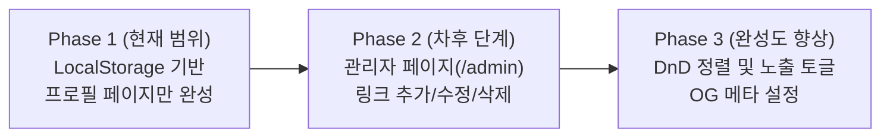

# [PRD] 개인용 링크트리 서비스 — 마이링크 (myLink)

> **버전**: v1.2 (사용자 시나리오 추가 및 시연용 단계별 구현 버전)  
> **목적**: 기능 시연(Live Demo) 흐름에 맞춘 단계별 빌드. **1단계에서는 대시보드/통계 없이 LocalStorage 기반 프로필 페이지만 집중 구현**합니다.

---

## 1. 프로젝트 개요 (Overview)

### 1.1 서비스 소개
**마이링크 (myLink)**는 개인 브랜딩과 포트폴리오를 한눈에 보여주는 토스(Toss) 스타일의 링크-인-바이오(Link-in-bio) 서비스입니다.  
시연 목적에 맞추어 복잡한 백엔드 설정 없이, **클라이언트 환경의 LocalStorage와 Mock 데이터**를 기반으로 즉시 동작하고 데이터가 유지되는 프로필 페이지를 1차 목표로 구현합니다.

### 1.2 핵심 전략: 단계별(Phased) 접근
- **현재 단계 (Phase 1 - 현재 집중 범위)**:
  - **프로필 페이지(`/`) 단일 집중 구현**
  - 대시보드(`/admin`), 인증, 통계 기능은 배제
  - `LocalStorage` 기반 데이터 스토어 연동 (데이터가 로컬에 저장·유지되며, 최초 진입 시 기본 Mock 데이터로 자동 시딩)
  - 토스(Toss) 스타일의 세련된 인터랙션 및 라이트/다크 모드 완성도 확보
- **차후 단계 (Phase 2 - 추후 확장)**:
  - 관리자 대시보드(`/admin`) 및 시각적 편집 인터페이스
  - 드래그 앤 드롭 링크 순서 변경 및 노출(Show/Hide) 토글

---

## 2. 사용자 페르소나 및 시나리오 (User Personas & Scenarios)

### 2.1 대상 페르소나 (Target Personas)

| 페르소나 | 주요 특징 및 니즈 | 주요 디바이스 |
| :--- | :--- | :--- |
| **방문자 A<br>(채용 담당자 / 동료 개발자)** | - SNS, 이력서, 깃허브 링크를 통해 방문<br>- 지원자의 대표 프로젝트, 주요 기술 스택, 링크 모음을 한 화면에서 빠르고 군더더기 없이 확인하길 원함<br>- 연락처(이메일)를 빠르게 복사하여 문의하고자 함 | 모바일 (70%) / 데스크톱 (30%) |
| **소유자 / 시연자 B<br>(크리에이터 / 데모 진행자)** | - 복잡한 인프라나 백엔드 배포 없이 브라우저 환경에서 즉시 동작하는 프로필을 시연하고자 함<br>- 로컬 스토리지에 데이터가 안정적으로 적재·유지되는 구조를 보여주고자 함 | 데스크톱 / 브라우저 개발자 도구 |

---

### 2.2 상세 사용자 시나리오 (End-to-End Scenarios)

#### 📌 시나리오 1: 모바일 SNS 링크를 통한 프로필 탐색
1. **상황**: 방문자가 인스타그램 프로필이나 이력서에 첨부된 마이링크 URL(`https://...`)을 클릭하여 접속합니다.
2. **화면 반응**:
   - 모바일 최적화된 토스 스타일의 깔끔한 카드 레이아웃이 지연(Loading) 없이 즉시 렌더링됩니다.
   - 상단에 소유자의 아바타 사진, 이름("홍길동"), 명확한 한 줄 소개("Next.js와 UI 인터랙션을 좋아하는 프론트엔드 엔지니어")가 눈에 들어옵니다.
3. **사용자 행동**: 상단의 GitHub, LinkedIn 아이콘 바를 탭하여 소유자의 외부 소셜 프로필로 바로 이동해 이력을 추가 확인합니다.

#### 📌 시나리오 2: 카테고리별 프로젝트 확인 및 외부 이동
1. **상황**: 방문자가 소유자의 대표 작업물을 탐색하고자 스크롤을 내립니다.
2. **화면 반응**:
   - `프로젝트`, `블로그 & 아티클` 등 카테고리별로 시각적으로 정돈된 섹션 구분선과 링크 카드가 노출됩니다.
   - 각 링크 카드에는 타이틀, 핵심 설명, 기술 태그/강조 뱃지(`NEW`, `HOT` 등)가 깔끔하게 정돈되어 있습니다.
3. **사용자 행동**: 관심 있는 'AI 바이브 코딩 플레이그라운드' 카드를 터치합니다.
4. **인터랙션 피드백**:
   - 카드가 살짝 눌리는 마이크로 인터랙션(`active:scale-[0.98]`) 피드백이 제공된 후 새 탭에서 실제 프로젝트 URL이 열립니다.

#### 📌 시나리오 3: 원클릭 이메일 복사 및 연락
1. **상황**: 채용 담당자가 소유자에게 커피챗 또는 협업 제안 메일을 보내고자 합니다.
2. **사용자 행동**: 프로필 헤더 하단의 이메일 주소 배지를 클릭합니다.
3. **화면 반응**:
   - 클립보드에 이메일 주소(`gildong.hong@example.com`)가 즉시 복사됩니다.
   - 화면 하단에 *"이메일 주소를 복사했어요"*라는 토스 스타일의 부드러운 토스트 알림이 2.4초간 노출되었다가 자연스럽게 사라집니다.

#### 📌 시나리오 4: 야간 모드(다크 모드) 전환
1. **상황**: 어두운 환경에서 접속한 방문자가 눈의 피로를 줄이고자 합니다.
2. **사용자 행동**: 우측 상단의 테마 전환(해/달 아이콘) 버튼을 탭합니다.
3. **화면 반응**:
   - 배경이 눈이 편안한 딥 차콜/블랙(`bg-[#121212]`)으로, 카드가 세련된 다크 그레이(`bg-[#1E1E1E]`)로 즉시 부드럽게 전환됩니다.
   - 폰트와 소셜 아이콘의 명암비가 WCAG 접근성 기준을 충족하도록 최적화되어 가독성이 유지됩니다.

#### 📌 시나리오 5: [시연자 관점] LocalStorage 기반 데이터 지속성 검증
1. **상황**: 시연자가 청중에게 "로컬 스토리지 기반의 클라이언트 데이터 지속성"을 입증합니다.
2. **시연 행동 1**: 브라우저를 처음 열었을 때 `localStorage`에 데이터가 비어있음을 확인한 뒤, 페이지 로드와 동시에 기본 Mock 데이터가 자동 주입(Seed)되는 과정을 보여줍니다.
3. **시연 행동 2**: 브라우저 개발자 도구(F12 > Application > Local Storage)에서 프로필 이름을 "김토스"로 변경하거나 링크 항목을 수정한 뒤 페이지를 새로고침합니다.
4. **결과**: 외부 서버 요청 없이도 로컬 스토리지에 저장된 변경 데이터가 프로필 페이지에 그대로 유지되어 반영되는 것을 확인시켜 줍니다.

---

## 3. 1단계 집중 범위: 프로필 페이지 기능 명세 (Phase 1 Scope)

### 3.1 주요 기능 목록

| ID | 기능명 | 상세 내용 | 필수 여부 |
| :--- | :--- | :--- | :--- |
| **P1-01** | **LocalStorage 데이터 연동** | - 브라우저 `localStorage`에 데이터(`MYLINK_DATA_V1`)가 없으면 기본 Mock 데이터를 주입(Seed)<br>- 로컬에 저장된 데이터를 읽어와 프로필 페이지 화면을 동적으로 렌더링 | `필수 (P0)` |
| **P1-02** | **프로필 헤더 영역** | - 아바타 이미지, 표시 이름, 한 줄 소개(Bio) 노출<br>- 이메일 주소 클릭 시 클립보드 복사 + 토스 스타일 토스트 알림 표시 | `필수 (P0)` |
| **P1-03** | **소셜 링크 아이콘 바** | - GitHub, LinkedIn, Instagram, X(Twitter), 이메일 등 등록된 소셜 계정을 아이콘 바 형태로 노출<br>- 클릭 시 새 탭으로 외부 링크 연결 | `필수 (P0)` |
| **P1-04** | **카테고리별 링크 카드 그룹** | - 카테고리(예: '프로젝트', '소셜 링크', '블로그')별 헤더 및 구분선 표시<br>- 링크 카드 항목: 제목, 상세 설명, URL, 뱃지(예: 'NEW', 'HOT'), 아이콘<br>- 노출 활성화(`isVisible: true`)된 링크만 필터링하여 출력 | `필수 (P0)` |
| **P1-05** | **토스 스타일 인터랙션 & 디자인** | - 카드 클릭/터치 시 `active:scale-[0.98]` 마이크로 애니메이션<br>- 부드러운 호버 효과 및 시각적 피드백<br>- 모바일 뷰 최적화 (Max width 480px 중앙 정렬) | `필수 (P0)` |
| **P1-06** | **라이트 / 다크 모드** | - 시스템 테마 감지 및 토글 스위치 지원<br>- 토스 그레이 컬러 토큰(`toss-gray`) 기반의 눈이 편안한 다크 모드 뷰 | `필수 (P0)` |

---

## 4. 데이터 구조 설계 (Phase 1 Schema)

LocalStorage에 저장되는 단일 데이터 구조로, 차후 어드민이 붙더라도 스키마 변경 없이 그대로 재사용 가능하도록 설계합니다.

```typescript
export interface MyLinkProfile {
  name: string;
  bio: string;
  email: string;
  avatarUrl: string;
}

export interface SocialLinks {
  github?: string;
  linkedin?: string;
  instagram?: string;
  x?: string;
  website?: string;
}

export interface LinkItem {
  id: string;
  categoryId: string;
  title: string;
  description?: string;
  url: string;
  badge?: string; // 예: 'NEW', 'HOT', '추천'
  icon?: string;
  isVisible: boolean; // 1단계에서는 true인 항목만 렌더링
  order: number;
}

export interface LinkCategory {
  id: string;
  name: string;
  order: number;
}

export interface MyLinkStore {
  profile: MyLinkProfile;
  socials: SocialLinks;
  categories: LinkCategory[];
  links: LinkItem[];
}
```

---

## 5. 단계별 로드맵 (Roadmap)



- **Phase 1 (현재 진행 대상)**:
  1. `types/mylink.ts`: TypeScript 데이터 모델 정의
  2. `constants/initialData.ts`: 토스 스타일 초기 Mock 데이터 작성
  3. `hooks/useMyLink.ts` (또는 Context): LocalStorage 로드/시딩 및 상태 제공
  4. `src/app/page.tsx`: 스토어와 결합된 완성도 높은 프로필 UI 렌더링
- **Phase 2 (현재 제외, 차후 진행)**:
  - `/admin` 라우트, 로그인 모달, 링크 편집 폼
- **제외 확정 항목**:
  - 방문자/클릭 통계 및 외부 분석 도구 (경량화 유지를 위해 제외)
